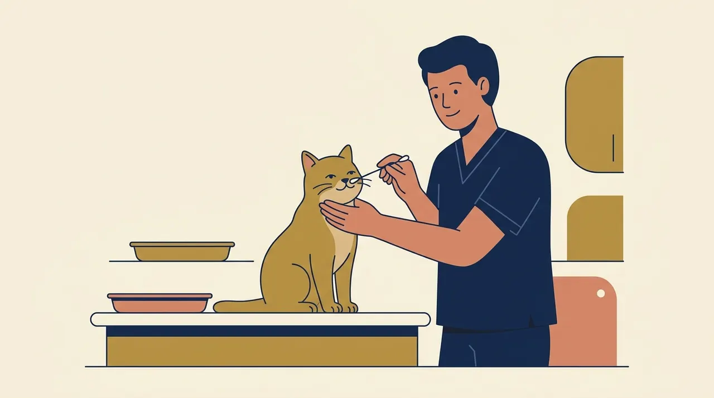

# Сколько здоровых домашних кошек носят стафилококк

_Исследование · 2016 год · Польша, Вроцлав · ветеринарный факультет Вроцлавского университета_

## Коротко

- У 415 здоровых домашних кошек взяли мазки. Золотистый стафилококк нашли примерно у каждой шестой.
- Его устойчивую к антибиотикам форму (MRSA) нашли примерно у одной кошки из пятнадцати.
- Чаще микроб был у кошек, чьи хозяева работают в медицине, у кошек, живущих с собакой, и у тех, кого недавно лечили антибиотиками.

## Какой вопрос задавали

Золотистый стафилококк: микроб, который живёт на коже и в носу у многих людей. Обычно он не вредит, но может вызвать гнойные болячки, а иногда и тяжёлую болезнь.

Учёные хотели узнать две вещи. Первое: как часто этот микроб есть у здоровой кошки, которая живёт в квартире и не выходит на улицу. Второе: от чего это зависит.

## Как это проверяли

С января 2013 по ноябрь 2014 года ветеринары осмотрели 415 кошек из 224 семей. Брали только здоровых кошек, которые не гуляют на улице. Так легче понять, откуда взялся микроб: у домашней кошки почти нет других источников, кроме дома и людей в нём.

У каждой кошки ватной палочкой взяли мазки из четырёх мест: из носа, с глаз, с кожи в паху и из-под хвоста. В лаборатории проверили, вырос ли из мазка стафилококк и устойчив ли он к антибиотикам.

Хозяева заполнили анкету про последний год: кто в семье лежал в больнице, кто работает врачом, медсестрой или ветеринаром, есть ли в доме другие животные, лечили ли кошку антибиотиками.

У самих людей мазки не брали. Это важно, мы к этому ещё вернёмся.

## Что получилось

- Золотистый стафилококк нашли у 17,5 % кошек. Это примерно каждая шестая.
- Устойчивую форму, MRSA, нашли у 6,63 % кошек. Это примерно одна из пятнадцати.
- Чаще всего микроб сидел в носу, на втором месте были глаза. Если бы мазок брали только из носа, часть кошек-носителей пропустили бы.
- Возраст, пол и порода кошки ни на что не влияли.

Микроб встречался чаще в четырёх случаях:

1. у кого-то в доме, человека или животного, за последний год уже находили стафилококк;
2. хозяин работает в больнице или ветеринарной клинике;
3. в доме живёт ещё и собака;
4. кошку за последний год лечили антибиотиками.

## Чему здесь можно верить, а чему нет

Верить можно главным цифрам. Кошек было много, мазки брали из нескольких мест, расчёт сделан аккуратно.

А вот чего исследование не показывает:

- **Кто кого заразил, неизвестно.** У людей мазки не брали. То, что микроб чаще находили у кошек медиков, подсказывает: кошка получает его от хозяина. Но это догадка, а не доказательство.
- **Кошку проверяли один раз.** Неизвестно, живёт микроб на ней месяцами или исчезает через неделю.
- **Анкету заполняли хозяева.** Они могли что-то забыть или перепутать.
- **Один город в одной стране.** В другом месте цифры могут быть другими. В похожих исследованиях получалось и меньше, и заметно больше.

## Что это значит для вас

Стафилококк у здоровой кошки бывает, и это не редкость. Но кошка при этом здорова, и для семьи она не главный источник микроба. У людей он встречается чаще: примерно у каждого третьего.

Что разумно делать:

- мыть руки после кошки и её лотка;
- не давать кошке лизать ранки и царапины;
- не лечить здоровую кошку антибиотиками «на всякий случай»: в исследовании как раз после антибиотиков микроб находили чаще.

Отдавать кошку из-за стафилококка это исследование повода не даёт.

## Непонятные слова

- **Золотистый стафилококк** (Staphylococcus aureus): микроб, который живёт на коже и в носу. У здорового человека обычно не вызывает болезни.
- **MRSA**: тот же стафилококк, но на него не действуют привычные антибиотики. Лечить его труднее.
- **Носитель**: тот, у кого микроб есть, а болезни нет.
- **Мазок**: проба, которую берут ватной палочкой.

## Оригинал

[Bierowiec K., Płoneczka-Janeczko K., Rypuła K. Prevalence and Risk Factors of Colonization with Staphylococcus aureus in Healthy Pet Cats Kept in the City Households. BioMed Research International, 2016](https://pubmed.ncbi.nlm.nih.gov/27766257/)

Пересказ сверен с полным текстом статьи 17 ноября 2026 года.
