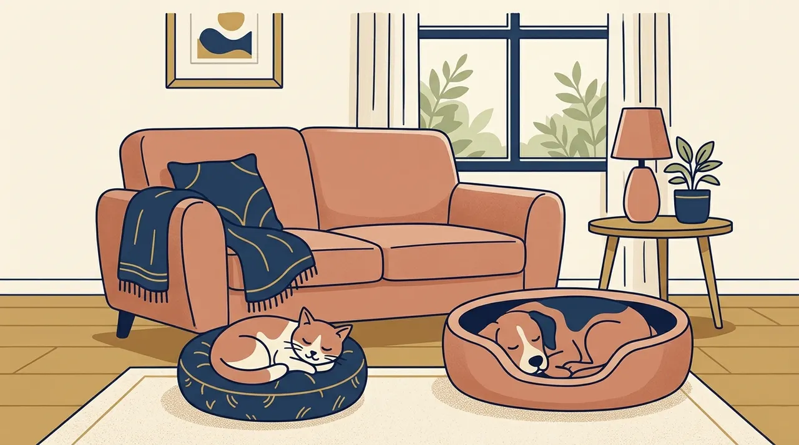

# Что происходит с питомцами, когда в семье кто-то болеет устойчивым стафилококком

_Исследование · 2023 год · США · университеты Джонса Хопкинса и Пенсильвании_

## Коротко

- В 57 семьях, где человек болел устойчивым стафилококком (MRSA), проверили 134 собаки и кошки. Микроб нашли у 12 из них.
- Почти всегда это был тот же самый микроб, что на вещах в доме, и такого типа, который обычно живёт у людей.
- Через три месяца больше половины питомцев-носителей избавились от микроба сами.

## Какой вопрос задавали

MRSA: это золотистый стафилококк, на который не действуют привычные антибиотики. У человека он чаще всего вызывает гнойные болячки на коже.

Учёные хотели понять: если в доме кто-то заболел MRSA, как часто микроб оказывается на собаке или кошке? И от чего это зависит: от самого питомца или от дома?

## Как это проверяли

Нашли людей, у которых врач недавно обнаружил кожную инфекцию от MRSA. Примерно через месяц после этого к ним приходили домой.

Дома делали три вещи:

1. брали мазки у собак и кошек: 71 собака и 63 кошки из 57 семей;
2. протирали салфеткой вещи в доме, в том числе лежанку питомца, и проверяли, есть ли на них микроб;
3. расспрашивали хозяев про питомца: возраст, блохи, лечили ли его антибиотиками.

Через три месяца приходили ещё раз. Повторно проверили 86 животных.

У каждого найденного микроба определяли «тип». Это как отпечаток пальца: если тип у питомца, у человека и на вещах одинаковый, значит, это один и тот же микроб, который ходит по дому.

## Что получилось

- MRSA нашли у 12 из 134 питомцев. Это примерно каждый одиннадцатый.
- Среди кошек: у 7 из 63. Среди собак: у 5 из 71.
- Питомцы-носители нашлись в 8 семьях из 57. В остальных 49 семьях животные были чистыми, хотя человек в доме болел.
- Все питомцы с микробом жили в домах, где микроб нашли и на вещах, которых касаются люди.
- У 11 из 12 питомцев тип микроба совпал с тем, что нашли на вещах в доме.
- Чаще всего это был тип, который в США самый частый именно у людей.

Микроб на питомце встречался чаще, если:

- он был на лежанке питомца (самая сильная связь);
- питомца лечили антибиотиками;
- у питомца были блохи.

Что стало через три месяца с девятью питомцами, у которых микроб нашли в первый раз: пятеро от него избавились, у четверых он остался. Ещё у четырёх животных, которые сначала были чистыми, микроб появился.

## Чему здесь можно верить, а чему нет

Сильная сторона: проверяли сразу и питомцев, и дом, и сравнивали типы микроба. Поэтому вывод «по дому ходит один и тот же микроб» надёжный.

Чего исследование не показывает:

- **Кто кого заразил, по-прежнему не доказано.** Авторы сами пишут, что не могут отличить, заразился питомец или микроб просто попал на его шерсть с вещей. Но всё указывает в одну сторону: первым заболел человек, тип микроба «человеческий», и на вещах в доме он тоже есть.
- **Семей немного.** 12 питомцев-носителей: это мало для точных расчётов. Связь с блохами, например, могла получиться случайно.
- **Все эти семьи особые.** В каждой человек уже болел и обычно уже лечился антибиотиками. На обычную семью, где никто не болеет, эти цифры переносить нельзя.
- **Один регион США.**

## Что это значит для вас

Если в семье кто-то заболел устойчивым стафилококком, питомец может его подхватить. Но чаще всего не подхватывает, а если подхватил, то нередко избавляется от него сам.

Авторы прямо пишут: забирать питомца из дома, где болеет человек, обычно не нужно. Они ссылаются на рекомендации ветеринаров, по которым человек заражает питомца чаще, чем питомец заново заражает человека.

Что разумно делать, если в семье кто-то болеет:

- постирать лежанку питомца: именно на ней микроб находили чаще всего. Помогает ли это, ещё не проверяли, но вреда точно нет;
- мыть руки после питомца и перед едой;
- закрывать больные места на коже повязкой;
- если болячки у людей возвращаются снова и снова, сказать об этом и врачу, и ветеринару: тогда питомца имеет смысл проверить.

## Непонятные слова

- **MRSA**: золотистый стафилококк, на который не действуют привычные антибиотики.
- **Носитель**: тот, у кого микроб есть, а болезни нет.
- **Мазок**: проба, которую берут ватной палочкой.
- **Тип микроба**: признак, по которому в лаборатории отличают одну «семью» стафилококка от другой.

## Оригинал

[Cotter C. J., Ferradas C., Ludwig S. и соавт. Risk factors for meticillin-resistant Staphylococcus aureus (MRSA) carriage in MRSA-exposed household pets. Veterinary Dermatology, 2023](https://pubmed.ncbi.nlm.nih.gov/36331035/)

Пересказ сверен с полным текстом статьи 17 ноября 2026 года.
