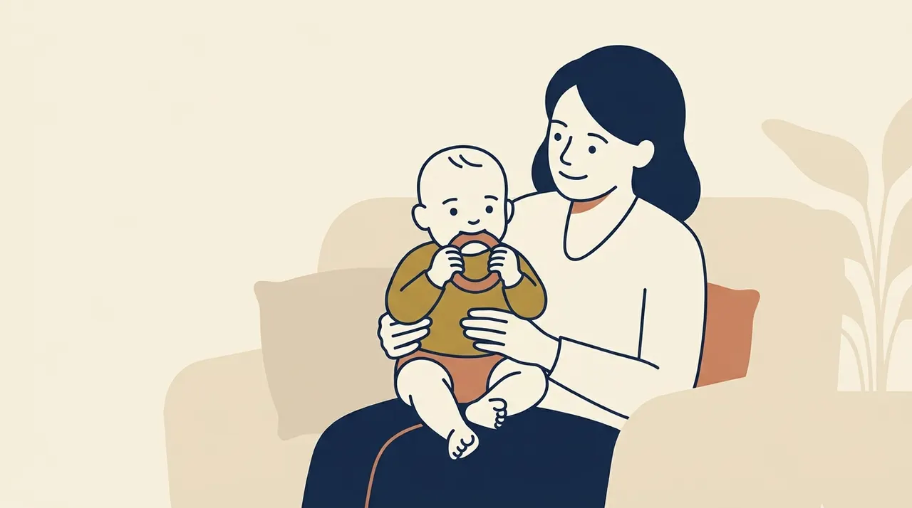

# FDA: бусы и браслеты от прорезывания зубов опасны для детей

_Памятка · 2018 год · США · Управление по контролю качества пищевых продуктов и лекарств (FDA)_

## Коротко

- FDA предупредило родителей: украшения «от зубов», например янтарные бусы, нельзя надевать на детей. Они могут задушить ребёнка или он может ими подавиться.
- Поводом стали сообщения о тяжёлых случаях. Один ребёнок, 18 месяцев, погиб: его задушили янтарные бусы во время дневного сна.
- FDA также советует не мазать дёсны ребёнку кремами и гелями с бензокаином и другими обезболивающими: они могут вызвать опасное для жизни состояние.

## Какой вопрос задавали

Когда у малыша режутся зубы, дёсны болят и чешутся. Многие родители надевают ребёнку бусы или браслет из янтаря, дерева, мрамора или силикона. Считается, что это облегчает боль.

FDA: это государственное ведомство США, которое следит за безопасностью лекарств, еды и медицинских изделий. Оно решило предупредить родителей, врачей и всех, кто ухаживает за детьми, чем опасны такие украшения.

Этот текст: заметка новостного сайта News-Medical. Она почти дословно повторяет пресс-релиз FDA от декабря 2018 года.

## Как это проверяли

Специального исследования здесь нет. FDA получило небольшое число сообщений о вреде от таких украшений, среди них один случай смерти. На этом основании ведомство выпустило предупреждение.

В тексте описаны два случая:

1. ребёнок 7 месяцев подавился бусинами деревянного браслета «для зубов». Родители были рядом, ребёнка отвезли в больницу;
2. ребёнок 18 месяцев погиб во время дневного сна: его задушили собственные янтарные бусы.

## Что получилось

FDA перечисляет, чем опасны такие украшения:

- **Ребёнок может подавиться.** Нитка рвётся, маленькая бусина попадает в горло или дыхательные пути.
- **Бусы могут задушить.** Если они слишком туго обхватили шею или зацепились за что-то, например за кроватку.
- **Можно поранить рот или занести инфекцию.** Если кусочек украшения царапает или прокалывает дёсны.

Про янтарь отдельно. Производители пишут, что из янтаря в кровь ребёнка выходит янтарная кислота, и она якобы снимает воспаление и боль. FDA пишет: сколько её выходит, неизвестно, а эти обещания ведомство на безопасность и пользу не проверяло. Родителям оно советует такими бусами не пользоваться.

То же предупреждение касается людей с особыми потребностями, например с аутизмом или СДВГ. Им такие украшения иногда дают погрызть вместо одежды или пальцев.

Что FDA предлагает вместо этого, со ссылкой на Американскую академию педиатрии:

- растирать воспалённые дёсны чистым пальцем;
- давать ребёнку прорезыватель: кольцо из твёрдой резины.

И ещё одно. FDA по-прежнему советует не давать детям при боли в дёснах кремы, гели, спреи, мази, растворы и пастилки с бензокаином и другими обезболивающими, которые действуют на месте. Они могут вызвать метгемоглобинемию: состояние, при котором кровь переносит меньше кислорода. Это опасно для жизни и может закончиться смертью.

## Чему здесь можно верить, а чему нет

Это официальное предупреждение государственного ведомства. Ему можно верить как предупреждению: риск удушья и того, что ребёнок подавится, понятен и без больших исследований.

Но есть оговорки:

- **Это не исследование.** Сколько всего детей пострадало, здесь не сказано. Сказано только, что сообщений было немного и что был один случай смерти.
- **Это пересказ.** Текст взят с новостного сайта, который перепечатал пресс-релиз FDA. Сама страница FDA в нём указана как источник.
- **Про пользу бус ведомство ничего не проверяло.** Оно не утверждает, что янтарь точно не помогает. Оно говорит, что польза не доказана, а риск есть.

## Что это значит для вас

Не надевайте ребёнку на шею, руку или ногу бусы и браслеты, чтобы облегчить прорезывание зубов. Особенно опасно оставлять их во время сна.

Если дёсны болят, FDA советует растереть их чистым пальцем или дать резиновое кольцо-прорезыватель.

Гели и кремы с бензокаином и другими местными обезболивающими для детских дёсен FDA использовать не советует.

## Непонятные слова

- **FDA**: государственное ведомство США, которое следит за безопасностью лекарств, еды и медицинских изделий.
- **Прорезыватель**: игрушка из твёрдой резины, которую малыш грызёт, когда режутся зубы.
- **Бензокаин**: обезболивающее, которое «замораживает» место, где им намазали.
- **Метгемоглобинемия**: состояние, при котором кровь хуже переносит кислород. Опасно для жизни.
- **СДВГ**: синдром дефицита внимания и гиперактивности.

## Оригинал

[News-Medical. FDA warns against use of jewelry to relieve teething pain in children, 2018](https://www.news-medical.net/news/20181221/FDA-warns-against-use-of-jewelry-to-relieve-teething-pain-in-children.aspx)

Пересказ сверен с полным текстом заметки, перепечатавшей пресс-релиз FDA, 17 ноября 2026 года.
