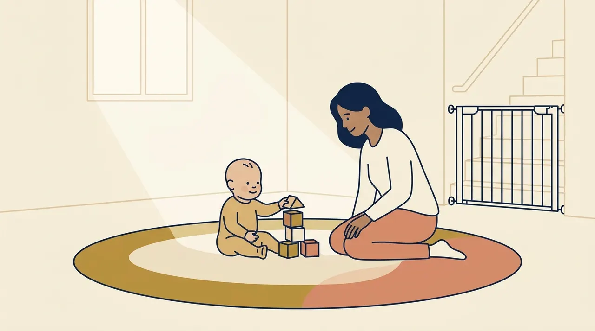

# Ходунки до сих пор приводят малышей в травмпункт

_Памятка · 2018 год · США (Колумбус, Огайо) · детская больница Nationwide Children's Hospital_

## Коротко

- С 1990 по 2014 год в США больше 230 000 детей младше 15 месяцев попали в приёмный покой из-за травм, связанных с ходунками.
- Почти все травмы были травмами головы или шеи. Чаще всего ребёнок в ходунках падал с лестницы.
- Травм стало намного меньше, но авторы пишут: ходунки не дают ребёнку никакой пользы, и пользоваться ими не стоит.

## Какой вопрос задавали

Ходунки: это рамка на колёсиках с сиденьем посередине. Ребёнок сидит в ней и ездит по дому, отталкиваясь ногами.

Это пресс-релиз больницы. Он рассказывает о научной статье, которую её сотрудники напечатали в журнале Pediatrics. Учёные из центра по изучению травм хотели узнать две вещи. Первое: какие травмы бывают у детей в ходунках. Второе: помогли ли правила безопасности, которые в США ввели для ходунков, сделать их безопаснее.

## Как это проверяли

Учёные взяли данные из большой государственной базы NEISS. Её ведёт комиссия США по безопасности товаров. В эту базу попадают травмы, связанные с бытовыми вещами, с которыми люди приходят в приёмные отделения больниц по всей стране.

Из базы выбрали все случаи с ходунками у детей младше 15 месяцев за 25 лет, с 1990 по 2014 год.

Потом сравнили, как менялось число травм после двух шагов:

1. в 1997 году появилось добровольное правило: ходунки должны быть шире обычной двери или сами останавливаться, если колесо съезжает со ступеньки;
2. в июне 2010 года правила стали обязательными и строже. Добавили, например, проверку стояночного тормоза. Ходунки, которые не подходят под правила, стало проще не пускать в страну.

## Что получилось

- Больше 230 000 детей младше 15 месяцев лечили в приёмном покое из-за ходунков за эти 25 лет.
- В 1990 году таких травм было 20 650, в 2014 году 2 001. То есть примерно в десять раз меньше.
- Меньше стало в основном падений с лестницы. Отчасти это заслуга новых правил для ходунков.
- За 4 года после обязательных правил 2010 года травм было ещё на 23 % меньше, чем за 4 года до них. Это примерно на четверть меньше. Авторы считают, что дело могло быть отчасти в правилах, а отчасти в том, что ходунками просто стали меньше пользоваться.
- 91 % травм пришлись на голову или шею. Это почти все.
- Около 30 % травм были сотрясением мозга, другой закрытой травмой головы или переломом черепа. Это примерно каждая третья.

Три главные причины травм:

1. падение в ходунках с лестницы;
2. падение из ходунков;
3. ребёнок доехал туда, куда сам бы не добрался, и дотянулся до опасного. Чаще всего это были ожоги от горячих предметов.

Руководитель исследования, доктор Гэри Смит, объясняет: ходунки дают маленькому ребёнку скорость до 4 футов в секунду, это больше метра в секунду. А ребёнок по своему развитию ещё не готов так быстро двигаться. Поэтому авторы поддерживают призыв Американской академии педиатрии запретить в США производство, продажу и ввоз ходунков.

## Чему здесь можно верить, а чему нет

Верить можно главным цифрам. Они взяты из большой государственной базы за много лет.

Но есть оговорки:

- **Это пресс-релиз, а не сама статья.** Он короткий и пересказывает только главное. Подробностей о том, как считали, здесь нет.
- **Считали только тех, кто попал в приёмный покой.** Синяки и шишки, с которыми к врачу не ходили, в эти цифры не вошли. Настоящих травм больше.
- **Это данные США.** Там свои правила для ходунков, свои дома и лестницы.
- **Про пользу для ходьбы здесь одна фраза.** Пресс-релиз говорит, что ходунки не дают ребёнку пользы. Как именно это проверяли, в нём не рассказано: исследование было про травмы.

## Что это значит для вас

Ходунки не помогают малышу, а травмы от них бывают, и часто серьёзные: голова, шея, ожоги. Даже новые, «безопасные» ходунки продолжают приводить детей к врачу.

Врачи, которые делали это исследование, советуют семьям ходунками не пользоваться. А Американская академия педиатрии вообще предлагает их запретить.

Если ходунки уже есть дома, помните, откуда берутся травмы: лестница, падение из ходунков, горячее и опасное, до чего ребёнок вдруг может дотянуться.

## Непонятные слова

- **Ходунки**: рамка на колёсиках с сиденьем, в которой ребёнок ездит по полу, отталкиваясь ногами.
- **Приёмный покой**: отделение больницы, куда приходят или привозят с внезапной травмой или болезнью.
- **Пресс-релиз**: короткое сообщение для журналистов о новом исследовании.
- **Закрытая травма головы**: удар по голове без раны, например сотрясение мозга.
- **NEISS**: государственная база данных США о травмах от бытовых вещей.

## Оригинал

[Nationwide Children's Hospital. Injuries Associated with Infant Walkers Still Sending Children to the Emergency Department. Пресс-релиз, 2018](https://www.nationwidechildrens.org/newsroom/news-releases/2018/09/injuries-associated-with-infant-walkers-sending-kids-to-the-emergency-department)

Пересказ сверен с пресс-релизом больницы 17 ноября 2026 года.
